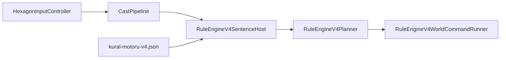

# Mimari (ARCHITECTURE.md)

v4.5 alfa dilimi: **Core** (saf C#) → **App** (use case) → **Game** (Unity). İş sırası
`docs/tasarim/14-kodlama-plani.md`; konu haritası `docs/MAP.md`; oyun özeti `docs/OYUN.md`.

## Bugün (17 Ekim 2026)

| Konu | Durum |
|------|--------|
| Skill yürütme | Tek yol: `Game/Skills/RuleEngineV4SentenceHost` + `RuleEngineV4Planner` + dünya komutları; veri `kural-motoru-v4.json` |
| Eski motor | Kaldırıldı (Aşama 3 ✅): `ManifestationDirector`, `MechanicGrammar`, `MechanicWorldRuntime`, `SkillExecutorRouter`, `RuleEngineV4Feature`, `element-sistemi.json` |
| Sahne | `GameBootstrapHost` + `Composition/Builders/*` (`Prototype.unity` yalnızca bootstrap) |
| Boss (dilim) | `aglarin_kralicesi` — `BossDirector` + `App/Boss/BossBrain` |
| Boss (hedef) | `Core/Boss/KulEjderiBrain` iskeleti; Unity bağlantısı `17` hattında |
| Girdi | `HexagonInputController` → `CastPipeline` |
| Sayılar | `*Defaults` const + JSON; ratchet: `MagicNumberRatchetTests`, `GameplayLiteralRatchetTests` |

## Katmanlar

```
unity/Assets/Scripts/
├── Core/          Dovus.Core — saf C#, noEngineReferences
├── App/           Dovus.App — CastPipeline, BossBrain, PlayerHealth, …
├── Game/          Dovus.Game.* — Unity sunum, RuleEngineV4 host'ları, bootstrap
├── Game/Composition/   GameBootstrapHost, Builders
├── Game/DevTools/      debug HUD (UNITY_EDITOR || DOVUS_DEBUG)
└── Game/Editor/        menüler, AndroidBuilder, test araçları
```

**Bağımlılık:** Game → App → Core. Core içinde `using UnityEngine` yasak.

## v4.5 cast akışı



Konum skill sırasında: `MotionTemplateRunner` + `MotionTemplateBodyHost` + `PositionOwnership` (tek yazıcı).

## Core domain modülleri (yeni iskelet)

| Klasör | Rol |
|--------|-----|
| `Hit` | İsabet / darbe modeli (genişleyen) |
| `Trial` | Deneme döngüsü, wipe kartı, silah yükü (`TrialLoop`, `TrialResult`) |
| `Team` | Takım görevi, dost AI (`AllyBrain`, `TeamTask*`) |
| `Cancel` | Üç faz + iptal/tampon (swap cancel için) |
| `Targeting` | `TargetLock`, kilit noktası |
| `Boss` | Dilim boss + `KulEjderiBrain`, `BossActionRunner` |
| `Grammar`, `Damage`, `Dodge`, `Status`, `Equipment`, `Motion`, `Tuning`, … | Mevcut dövüş grameri |

Unity bağlantısı Aşama 4–8 PR'larında; Core testleri `dotnet test tools/CoreTests`.

## Core katman sırası

Üst klasör grafiği ve SCC kapısı: `tools/CoreTests/CoreLayeringTests.cs`.

1. **Shared**, **Border**, **Time**, **Hud**, **Data**
2. **Element**, **Input**, **Tuning**
3. **Presentation**, **Manifestation**, **Grammar**, **Motion**, **Portal**, **Team**
4. **Boss**, **Casting**, **Damage**, **Dodge**, **Equipment**, **Passives**, **Status** — izinli tek güçlü SCC (ratchet: yeni SCC yasak)

## Game katmanı

Üst klasör grafiği: `tools/CoreTests/GameLayeringTests.cs`.

- **Composition** — yalnız kurucular; runtime klasörler `Dovus.Game.Composition` kullanmaz.
- **Skills** — RuleEngineV4 partial host'lar, presentation köprüleri.
- **Platform**, **Diagnostics**, **DevTools** — saat, debug (DevTools ayrı asmdef).

## Skill modeli

- **Katalog:** `SkillMotor` + `SliceGrammarDefaults` / `kural-motoru-v4.json`
- **Çözüm:** `SkillResolution` (gruplu alanlar; `SkillId`, wire enum'lar)
- **Yürütme:** v4 komut planı → `RuleEngineV4WorldCommandRunner` (eski `SkillExecutorRouter` kaldırıldı)

`SkillMotionPlan` / `SkillMotionMotor`: saf plan; konum yazmaz.

## Sessiz geri dönüş

v4.5 tek yol. Eksik klip, JSON veya kural: `Debug.LogError("[V4-FALLBACK] <yer>: <sebep>")` — sessiz yedek yok.

## İsimlendirme

### Tek dil

- Kod tanımlayıcıları: **İngilizce**. Yorumlar: Türkçe olabilir.
- JSON / tuning **veri sözcükleri** Türkçe veya snake_case kalabilir (sözlük tablosu).

### MonoBehaviour sonekleri (Game)

| Sonek | Rol |
|-------|-----|
| `*Director` | Orkestratör |
| `*View` | Görsel |
| `*Hud` | UI |
| `*Host` | Sahne kabuğu |
| `*Controller` | Girdi / kontrol |

`NamingConventionTests.Game_MonoBehaviours_UseStandardSuffix`: ≥79 bileşen, yalnız bu sonekler.

### Saf sınıf sonekleri

| Katman | Sonek |
|--------|-------|
| App / Core | `*Rules`, `*Math` |
| Game (non-MB) | `*Runtime`, `*Service` |
| Veri | `*Catalog`, `*Table` |

### Tarihsel yeniden adlar (2B.12b)

`PrototypeBootstrap` → `GameBootstrapHost`, `PortalBorderTeam*` → `TeamCombo*`, `V611DebugPanel` → `GrammarDebugHud`, vb. Tam tablo git geçmişinde; birleştirmede eski tip adı kullanma.

## Yorum kodu sözlüğü

Eski PR kısaltmaları; yeni yorumda kısa Türkçe tercih edilir.

| Kod | Anlam | Yer |
|-----|-------|-----|
| O1 | Dodge süre vs sürükleme eşiği | `DodgeTuning` |
| O3 | Portal geri vuruş çift sayım | `TeamComboHost` |
| O4 | Diriliş zamanlayıcısı dünya saati | `PlayerVitalsHost` |
| O7 | Savaş RNG (kritik) | `CritSystem` |
| F1 | Stasis → yavaşlatma (oyuncu donması kaldırıldı) | v4 his |
| T10 | Canlı ayar paneli + JSON round-trip | `TuningPanelHud` |
| 2B.x | Mimari alt iş (tarihsel) | git geçmişi |

## Veri sözlüğü

| Veri sözcüğü | Kod | Anlam |
|--------------|-----|--------|
| `bag_hatti` | — | Bağ şeridi / mermi silme |
| `iki_kez` | — | Çift vuruş |
| `genis_yay` | `WeaponPassiveKind.WideArc` | Pasif |
| Rün 1..12 | `Rune` | Fiil/sıfat; UI: `RuneInfo.DisplayName` |
| `elements[]` | `ElementId` | Boya; rün enum'undan ayrı |

## Oynanış sabitleri

Sayılar `Core/**/*Defaults.cs` ve `kural-motoru-v4.json`. Yeni literal: ratchet testleri düşürülerek taşınır; kaynak yoksa PR'da "kaynakta yok".
